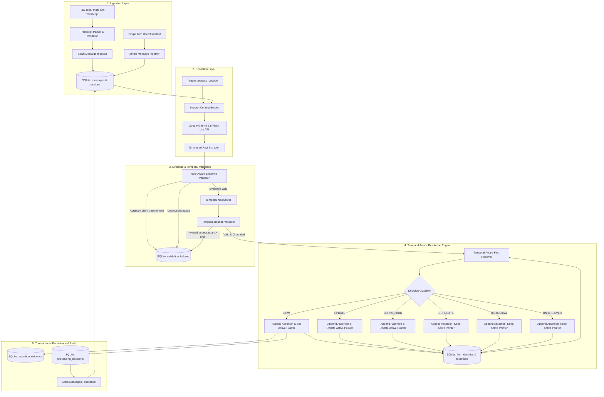

# CRAM — Architecture Document

## 1. System Overview

CRAM (**Context Resolution in AI Memory**) is a structured conversational memory architecture designed to extract, validate, resolve, and maintain durable real-world knowledge across multi-session human-AI conversations.

The core philosophy of CRAM strictly separates:
1. **Entities**: Distinct conversational subjects (User, named individuals, organizations, locations).
2. **Fact Identities**: Conceptual, canonical attributes of an entity (e.g., `User.residence`, `User.employer`).
3. **Assertions**: Immutable, append-only records of claims asserted at particular conversation turns.
4. **Evidence & Grounding**: Verbatim quotes, message links, and speaker role verification.
5. **Processing Decisions**: Complete audit trails of resolver decisions (`NEW`, `DUPLICATE`, `UPDATE`, `CORRECTION`, `UNRESOLVED`, `HISTORICAL`).
6. **Temporal Reasoning**: Explicit modeling of event times, partial date precision, relative date anchoring, status transitions, and separation of conversational arrival order from real-world chronological order.

---

## 2. Logical Component Architecture

---

## 3. Database Schema (SQLite)

The SQLite database is initialized with `PRAGMA foreign_keys = ON;` and WAL journal mode (`PRAGMA journal_mode = WAL;`). All migrations use explicit transaction and savepoint rollback strategies.

### `sessions`
Stores conversation sessions.
* `session_id` (TEXT, PK): Unique session identifier.
* `created_at` (TEXT): ISO8601 UTC timestamp.
* `updated_at` (TEXT): ISO8601 UTC timestamp.
* `status` (TEXT): Session lifecycle state (`active`, `processing`, `completed`, `error`).
* `metadata_json` (TEXT): Optional flexible session metadata.

### `messages`
Stores verbatim conversational turns.
* `message_id` (TEXT, PK): Unique message UUID.
* `session_id` (TEXT, FK -> sessions ON DELETE CASCADE): Associated session.
* `role` (TEXT): Speaker role (`user`, `assistant`, `system`).
* `content` (TEXT): Exact verbatim text.
* `timestamp` (TEXT): Message arrival timestamp (ISO8601 UTC).
* `turn_index` (INTEGER, NOT NULL): 1-indexed sequential turn order within the session.
* `is_processed` (INTEGER): `0` for unprocessed, `1` for processed.
* `retry_count` (INTEGER): Number of extraction retries.
* `error_message` (TEXT): Last error message if processing failed.
* *Constraints & Indexes*: `UNIQUE(session_id, turn_index)`, `INDEX idx_messages_session_turn`.

### `entities`
Stores conversational subjects.
* `entity_id` (TEXT, PK): Unique entity UUID.
* `name` (TEXT): Entity display name (`User`, `Rahul`, `Google`, `Brother`).
* `entity_type` (TEXT): Entity classification (`user`, `person`, `organization`, `project`, `location`, `other`).
* `canonical_name` (TEXT): Lowercase normalized identity.
* `created_at` (TEXT): ISO8601 timestamp.

### `fact_identities`
Stores conceptual facts belonging to an entity.
* `fact_id` (TEXT, PK): Unique conceptual fact identifier.
* `entity_id` (TEXT, FK -> entities ON DELETE CASCADE): Subject entity.
* `attribute` (TEXT): Original extracted attribute name.
* `canonical_attribute` (TEXT): Normalized semantic attribute family (e.g., `residence`, `employer`, `workplace`).
* `current_assertion_id` (TEXT): Pointer to the current active assertion representing real-world state.
* `status` (TEXT): Fact lifecycle state (`active`, `uncertain`, `retracted`).
* `created_at` (TEXT): ISO8601 timestamp.
* `updated_at` (TEXT): ISO8601 timestamp.

### `assertions`
Immutable, append-only log of claims asserted about a fact identity.
* `assertion_id` (TEXT, PK): Unique assertion UUID.
* `fact_id` (TEXT, FK -> fact_identities ON DELETE CASCADE): Associated conceptual fact.
* `entity_id` (TEXT, FK -> entities ON DELETE CASCADE): Subject entity.
* `attribute` (TEXT): Attribute name.
* `value_json` (TEXT): JSON serialization of parsed value.
* `raw_value` (TEXT): Human-readable extracted value.
* `temporal_expression` (TEXT): Original textual temporal expression (e.g., "in 2024", "yesterday", "used to").
* `event_start` (TEXT): Normalized ISO start date (`YYYY`, `YYYY-MM`, or `YYYY-MM-DD`).
* `event_end` (TEXT): Normalized ISO end date (`YYYY`, `YYYY-MM`, or `YYYY-MM-DD`).
* `event_status` (TEXT): Event lifecycle state (`planned`, `ongoing`, `completed`, `cancelled`).
* `temporal_type` (TEXT): Classification (`point`, `interval`, `relative`, `recurring`).
* `assertion_type` (TEXT): Relational status (`NEW`, `DUPLICATE`, `UPDATE`, `CORRECTION`, `UNRESOLVED`, `HISTORICAL`).
* `supersedes_assertion_id` (TEXT, FK -> assertions): Lineage link to superseded prior assertion.
* `session_id` (TEXT, FK -> sessions ON DELETE CASCADE): Source session.
* `confidence` (REAL): Confidence score (0.0 to 1.0).
* `created_at` (TEXT): ISO8601 timestamp.

### `assertion_evidence`
Grounding evidence linking assertions to source messages.
* `evidence_id` (TEXT, PK): Unique evidence UUID.
* `assertion_id` (TEXT, FK -> assertions ON DELETE CASCADE): Associated assertion.
* `message_id` (TEXT, FK -> messages ON DELETE CASCADE): Grounding source message.
* `evidence_quote` (TEXT): Verbatim substring from the source message.
* `is_exact_match` (INTEGER): `1` if exact substring, `0` if normalized match.
* `validation_status` (TEXT): `valid`, `partial`, `ungrounded`.
* `validation_notes` (TEXT): Grounding validation audit notes.
* `created_at` (TEXT): ISO8601 timestamp.

### `processing_decisions`
Comprehensive audit trail of resolver decisions.
* `decision_id` (TEXT, PK): Decision log UUID.
* `session_id` (TEXT, FK -> sessions ON DELETE CASCADE): Evaluated session.
* `candidate_assertion_id` (TEXT): Resulting assertion ID.
* `matched_fact_id` (TEXT): Matched prior fact identity (if any).
* `matched_assertion_id` (TEXT): Matched prior assertion (if any).
* `decision_type` (TEXT): `NEW`, `DUPLICATE`, `UPDATE`, `CORRECTION`, `UNRESOLVED`, `HISTORICAL`.
* `reason` (TEXT): Human-readable justification explaining the decision.
* `confidence` (REAL): Confidence score.
* `created_at` (TEXT): ISO8601 timestamp.

### `validation_failures`
Audit records of rejected candidate facts.
* `failure_id` (TEXT, PK): Log entry UUID.
* `session_id` (TEXT, FK -> sessions ON DELETE CASCADE): Session ID.
* `message_id` (TEXT): Source message ID if available.
* `candidate_json` (TEXT): Full candidate fact payload.
* `failure_reason` (TEXT): Grounding, role-validation, or temporal-bounds failure reason.
* `created_at` (TEXT): ISO8601 timestamp.

---

## 4. Key Subsystems & Principles

### 4.1 Ingestion & Turn Indexing (Feature 1, Phases 1 & 2)
- **Sequential Per-Session Turn Indexing**: Messages receive a strict 1-indexed `turn_index` allocated within an immediate SQLite transaction (`SELECT COALESCE(MAX(turn_index), 0) + 1`), immune to timestamp clock skew or concurrent writers.
- **Transcript Parser**: Parses multi-turn transcripts, normalizes role indicators (`User`, `Assistant`), strips CR/LF differences, rejects invalid preambles and blank turns, and stages batch inserts with atomic rollback on error.

### 4.2 Role-Aware Evidence Validation (Feature 1, Phase 4)
- **Assistant-Only Claim Guard**: Statements made solely by the assistant cannot independently establish durable real-world facts about the user or third parties.
- **Turn-Adjacent Confirmation**: When the assistant makes a claim, it is only accepted if followed immediately by an unambiguous affirmative user turn ("yes", "exactly", "that is right"). Qualified ("yes, but..."), uncertain ("maybe"), or contrastive answers are rejected in Python.

### 4.3 Cascade Reset & Deletion (Feature 1, Phase 3)
- **Delete All Sessions**: Provides explicit, safe purging of all stored sessions, messages, entities, fact identities, assertions, evidence, decisions, and validation failures in an atomic transaction, protected by a safety confirmation guard.

### 4.4 Temporal Data Model & Normalization (Feature 2, Milestone 1)
- **Structured Fields**: Stores `event_start`, `event_end`, `event_status`, and `temporal_type`.
- **Preservation of Precision**: Partial dates like `"2024"` and `"April 2024"` remain partial strings (`"2024"`, `"2024-04"`) rather than inventing arbitrary timestamps or days (`"2024-01-01"`).
- **Relative Date Anchoring**: Relative terms ("yesterday", "tomorrow") anchor to source message timestamps. If reference timestamps are unavailable or vague ("sometime next year"), dates are not invented.

### 4.5 Temporal Validation & Temporal-Aware Resolution (Feature 2, Milestone 2)
- **Interval Bounds Validation**: Rejects inverted intervals where $earliest(start) > latest(end)$ and impossible calendar dates.
- **Arrival Order vs Event Order**: Statements made in later conversation turns describing earlier events do not overwrite newer states. Instead, they produce `HISTORICAL` assertions that are preserved without mutating the active fact pointer.
- **Multi-Granularity Comparisons**: Evaluates intervals across `strictly_before`, `strictly_after`, `same`, `during`, `contains`, `ambiguous_overlap`, and `unspecified`.
- **Status Transitions**: Tracks forward transitions (`planned` $\to$ `ongoing` $\to$ `completed` / `cancelled`).
- **Cancellation Guard**: Cancelling an event sets `event_status="cancelled"` and audits that cancellation does not infer event occurrence.
- **Contradiction Detection**: Conflicting claims asserted for the exact same point in time or contradictory status reversals (`completed` $\to$ `cancelled` without correction) are resolved as `UNRESOLVED` rather than guessing.
