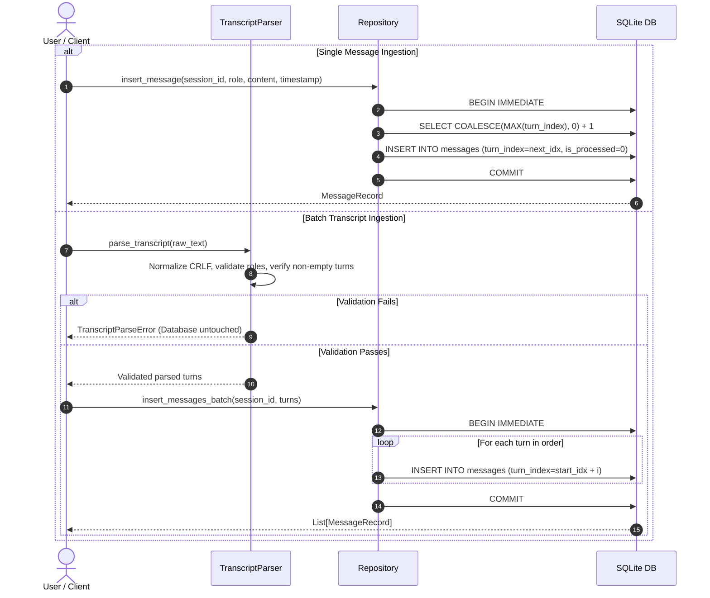
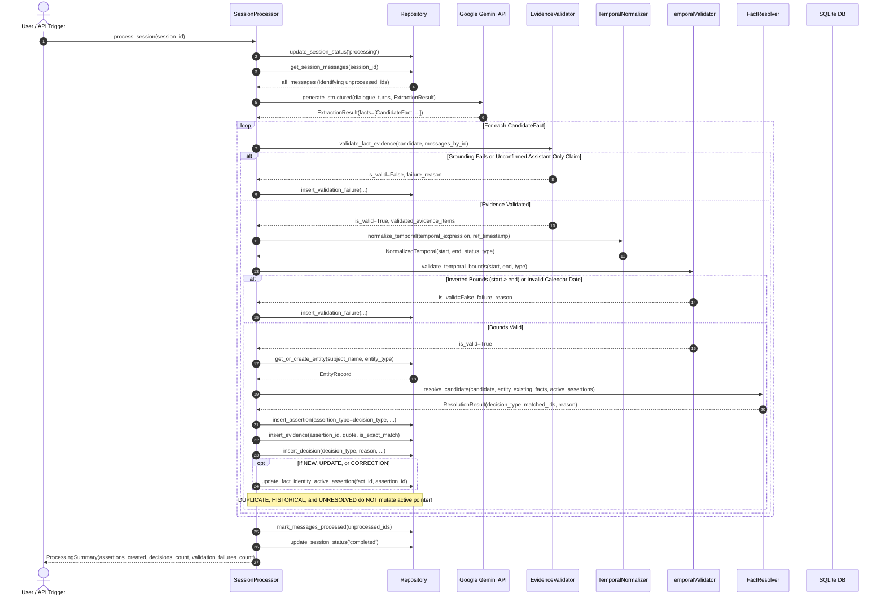

# CRAM — Project Flow & Execution Workflows

This document describes the end-to-end operational workflows implemented in CRAM across Feature 1 (Phases 1–4) and Feature 2 (Milestones 1–2).

---

## 1. Message & Transcript Ingestion Workflow

Incoming turns from the user or assistant are ingested and assigned strict sequential turn indexes before any processing occurs.



---

## 2. Session Fact Extraction & Multi-Stage Validation Workflow

Extraction and resolution are triggered via `process_session(session_id)`. Each candidate fact progresses through a multi-stage validation and resolution pipeline:



---

## 3. Fact Resolution Decision Matrix

| Candidate State vs Active Assertion | Temporal / Evidence Signal | Decision | Active Fact Pointer Action | Historical Assertion Lineage |
| :--- | :--- | :--- | :--- | :--- |
| **No prior fact** exists for `Entity + CanonicalAttribute` | Valid evidence | `NEW` | **Points** to new assertion | `supersedes_assertion_id = None` |
| **Identical value** and no status transition | Semantic duplicate | `DUPLICATE` | **Preserved** (Unchanged) | Appended without superseding |
| **Explicit Correction** | Correction cues ("was wrong", "mistake") | `CORRECTION` | **Updated** to corrected assertion | `supersedes_assertion_id = prior.id` |
| **Historical Statement** arriving later | Candidate concluded before active began (`strictly_before` or historical cue) | `HISTORICAL` | **Preserved** (Unchanged active state) | `supersedes_assertion_id = None` (Retained as historical record) |
| **Temporal Progression** | Candidate started after active concluded (`strictly_after`) | `UPDATE` | **Updated** to newer assertion | `supersedes_assertion_id = prior.id` |
| **Supported Status Transition** | `planned` $\to$ `ongoing` $\to$ `completed` or `planned`/`ongoing` $\to$ `cancelled` | `UPDATE` | **Updated** to new status | `supersedes_assertion_id = prior.id` (Cancellation notes no event occurrence) |
| **Contradictory Status Transition** | `completed` $\to$ `cancelled` or `cancelled` $\to$ `completed` without correction | `UNRESOLVED` | **Preserved** (Unchanged) | Appended as conflict record |
| **Conflicting Claims at Same Time** | Different values for identical date/interval bounds (`same`) | `UNRESOLVED` | **Preserved** (Unchanged) | Appended as conflict record |
| **Ambiguous Overlap** | Partial overlap (`during`, `contains`, `ambiguous_overlap`) without transition cues | `UNRESOLVED` | **Preserved** (Unchanged) | Appended without guessing precedence |
| **Assistant-Only Claim** | Assistant asserts fact without user confirmation | *REJECTED* | **None** | Recorded in `validation_failures` |
| **Inverted Temporal Bounds** | Event start occurs strictly after event end | *REJECTED* | **None** | Recorded in `validation_failures` |

---

## 4. Reset & Deletion Workflow ("Delete All Sessions")

When a user triggers a memory reset, CRAM performs a cascading deletion:

```mermaid
sequenceDiagram
    autonumber
    actor User as User
    participant UI as Streamlit UI / API
    participant Repo as Repository
    participant DB as SQLite DB

    User->>UI: Click "Delete All Sessions"
    UI->>User: Display explicit confirmation guard checkbox
    User->>UI: Confirm deletion & click "Proceed"
    
    UI->>Repo: delete_all_sessions()
    Repo->>DB: BEGIN IMMEDIATE
    Repo->>DB: DELETE FROM messages
    Repo->>DB: DELETE FROM sessions
    Repo->>DB: DELETE FROM assertions (cascades evidence)
    Repo->>DB: DELETE FROM fact_identities
    Repo->>DB: DELETE FROM entities
    Repo->>DB: DELETE FROM processing_decisions
    Repo->>DB: DELETE FROM validation_failures
    Repo->>DB: COMMIT
    
    DB-->>Repo: Success
    Repo-->>UI: Stats (deleted counts across all tables)
    UI-->>User: Memory reset complete; fresh session ready
```
